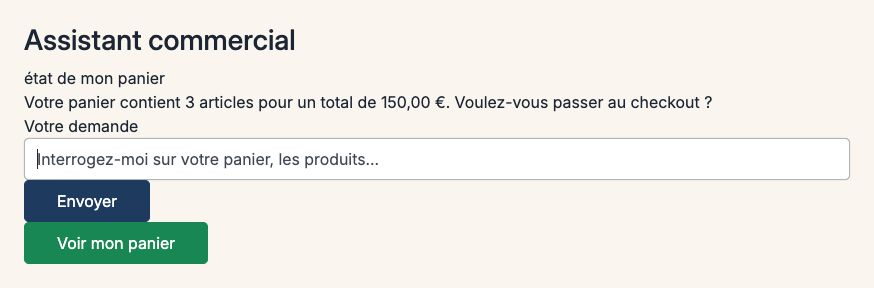

# Plugin Copilote d'Achat B2B pour Sylius

[English](README.md) | Français

Squelette d'assistant d'achat conversationnel pour Sylius 2 B2B : un widget dans le compte client envoie les demandes à un modèle de copilote derrière un port (`CopilotModelInterface`). Cette version ne livre que l'**adaptateur rejoué** : les réponses viennent de cassettes enregistrées, sans appel à une API de LLM.

**Démo** : [https://sylius-b2b.thibaut-monier.fr](https://sylius-b2b.thibaut-monier.fr)  
**Auteur** : [Thibaut Monier](https://www.linkedin.com/in/thibautmonier/)

## Fonctionnalités

- **Widget conversationnel** dans le tableau de bord du compte client (Stimulus, utilisable au clavier, réponses annoncées par une région live)
- **Mode rejoué** : une demande enregistrée renvoie sa réponse enregistrée ; toute autre demande renvoie « scénario non enregistré en démo »
- **Garde d'accès** : l'API du chat refuse les visiteurs anonymes (401) et les canaux absents de `enabled_channels` (403) ; le widget ne s'affiche que sur les canaux activés

Les actions en langage naturel sur la boutique (recommande, ajout rapide, devis) via des outils MCP sont prévues pour une version ultérieure.

## Prérequis

- PHP `^8.2`
- Sylius `^2.2.9 || ^2.3`
- Symfony `^7.4 || ^8.0`

## Installation

```bash
composer require tmonier/sylius-b2b-sales-copilot-plugin
```

Activez le bundle dans `config/bundles.php` :

```php
return [
    // ...
    Tmonier\SyliusB2bSalesCopilotPlugin\TmonierSyliusB2bSalesCopilotPlugin::class => ['all' => true],
];
```

Importez les routes dans `config/routes/tmonier_sylius_b2b_sales_copilot.yaml` :

```yaml
tmonier_sylius_b2b_sales_copilot:
    resource: "@TmonierSyliusB2bSalesCopilotPlugin/config/routes.yaml"
```

Enregistrez le contrôleur du widget dans le point d'entrée des assets de la boutique :

```js
import '@vendor/tmonier/sylius-b2b-sales-copilot-plugin/assets/shop/entrypoint';
```

## Configuration

Listez les canaux où le copilote est disponible (canaux B2B) :

```yaml
# config/packages/tmonier_sylius_b2b_sales_copilot.yaml
tmonier_sylius_b2b_sales_copilot:
    enabled_channels: ['B2B_WEB']
```

Les réponses enregistrées sont dans `config/cassettes.jsonl` (JSONL, une demande enregistrée par ligne).

### Exemple de cassette

```jsonl
{"version":"1.0","intent":"état de mon panier","normalized":{"action":"get_cart"},"timestamp":"2026-10-30T10:00:00Z","tools":[{"name":"get_checkout_link","args":{},"result":"success"}],"response":"Votre panier contient 3 articles pour un total de 150,00 €. Voulez-vous passer au checkout ?"}
```

## Utilisation

Un client connecté sur un canal activé voit le widget du copilote dans le tableau de bord de son compte et peut envoyer une demande. Une demande enregistrée (par exemple « état de mon panier ») renvoie sa réponse enregistrée.

Le widget est accroché à `sylius_shop.account.dashboard.index.content.main.section`. Un thème qui remplace le tableau de bord peut l'inclure directement : `` (il n'affiche rien en dehors des canaux activés).

## Captures d'écran



## Développement

### Lancer les tests

```bash
composer install
vendor/bin/phpunit --testsuite=all
```

### Qualité du code

```bash
vendor/bin/phpstan analyse
vendor/bin/ecs check
vendor/bin/rector process --dry-run
```

## Licence

MIT. Voir le fichier [LICENSE](LICENSE).

## Auteur

**Thibaut Monier**  
LinkedIn : [https://www.linkedin.com/in/thibautmonier/](https://www.linkedin.com/in/thibautmonier/)

## Contribuer

Les contributions sont les bienvenues. Veuillez ouvrir une issue ou une pull request sur GitHub.
