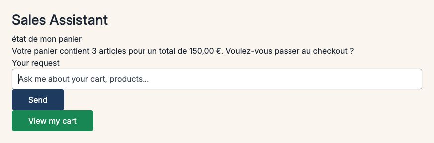

# Sylius B2B Sales Copilot Plugin

English | [Français](README.fr.md)

Conversational purchasing assistant skeleton for Sylius 2 B2B: a widget in the customer account sends requests to a copilot model behind a port (`CopilotModelInterface`). This version ships the **replay adapter** only: answers come from pre-recorded cassettes, with no call to an LLM API.

**Demo**: [https://sylius-b2b.thibaut-monier.fr](https://sylius-b2b.thibaut-monier.fr)  
**Author**: [Thibaut Monier](https://www.linkedin.com/in/thibautmonier/)

## Features

- **Conversational widget** in the customer account dashboard (Stimulus, keyboard accessible, answers announced by a live region)
- **Replay mode**: recorded requests return their recorded answer; any other request returns « scénario non enregistré en démo »
- **Access guard**: the chat endpoint refuses anonymous visitors (401) and channels outside `enabled_channels` (403); the widget is only rendered on enabled channels

Natural-language actions on the store (reorder, quick add, quotes) through MCP tools are planned for a later version.

## Requirements

- PHP `^8.2`
- Sylius `^2.2.9 || ^2.3`
- Symfony `^7.4 || ^8.0`

## Installation

```bash
composer require tmonier/sylius-b2b-sales-copilot-plugin
```

Enable the bundle in `config/bundles.php`:

```php
return [
    // ...
    Tmonier\SyliusB2bSalesCopilotPlugin\TmonierSyliusB2bSalesCopilotPlugin::class => ['all' => true],
];
```

Import the routes in `config/routes/tmonier_sylius_b2b_sales_copilot.yaml`:

```yaml
tmonier_sylius_b2b_sales_copilot:
    resource: "@TmonierSyliusB2bSalesCopilotPlugin/config/routes.yaml"
```

Register the widget controller in your shop assets entrypoint:

```js
import '@vendor/tmonier/sylius-b2b-sales-copilot-plugin/assets/shop/entrypoint';
```

## Configuration

List the channels where the copilot is available (B2B channels):

```yaml
# config/packages/tmonier_sylius_b2b_sales_copilot.yaml
tmonier_sylius_b2b_sales_copilot:
    enabled_channels: ['B2B_WEB']
```

Recorded answers live in `config/cassettes.jsonl` (JSONL, one recorded request per line).

### Example cassette

```jsonl
{"version":"1.0","intent":"état de mon panier","normalized":{"action":"get_cart"},"timestamp":"2026-10-30T10:00:00Z","tools":[{"name":"get_checkout_link","args":{},"result":"success"}],"response":"Votre panier contient 3 articles pour un total de 150,00 €. Voulez-vous passer au checkout ?"}
```

## Usage

A signed-in customer on an enabled channel sees the copilot widget on the account dashboard and can send a request. A recorded request (for example « état de mon panier ») returns its recorded answer.

The widget is hooked into `sylius_shop.account.dashboard.index.content.main.section`. A theme that replaces the dashboard can include it directly: `` (it renders nothing outside the enabled channels).

## Screenshots



## Development

### Running tests

```bash
composer install
vendor/bin/phpunit --testsuite=all
```

### Code quality

```bash
vendor/bin/phpstan analyse
vendor/bin/ecs check
vendor/bin/rector process --dry-run
```

## License

MIT. See [LICENSE](LICENSE) file.

## Author

**Thibaut Monier**  
LinkedIn: [https://www.linkedin.com/in/thibautmonier/](https://www.linkedin.com/in/thibautmonier/)

## Contributing

Contributions are welcome. Please open an issue or pull request on GitHub.
